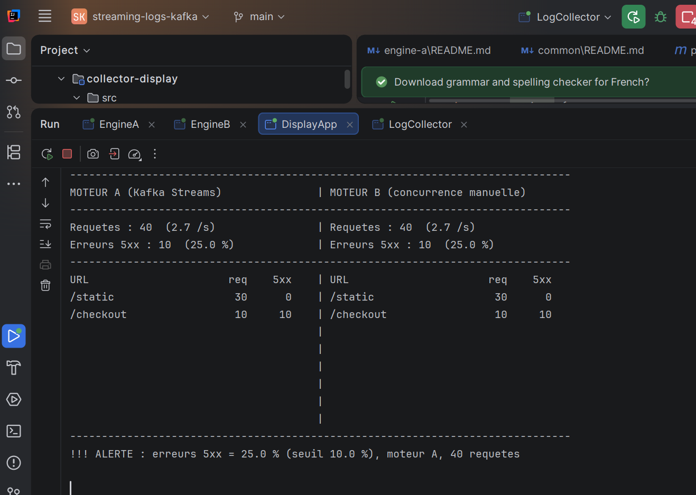
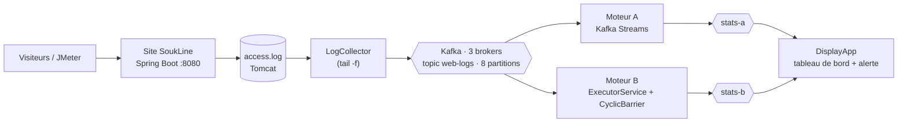
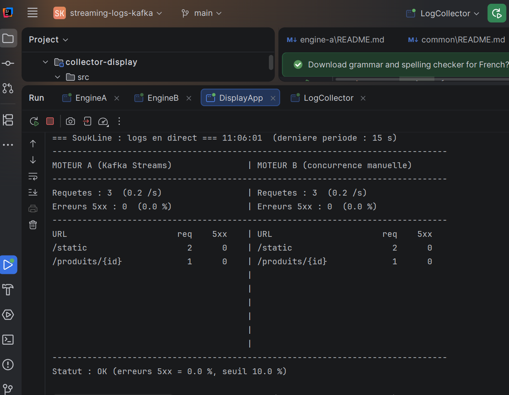
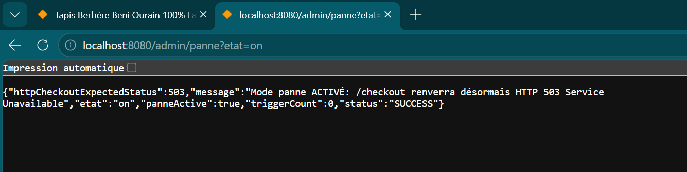
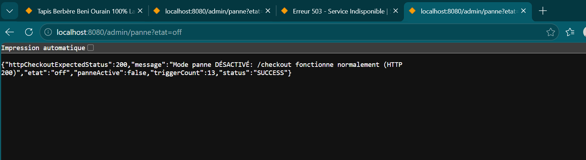
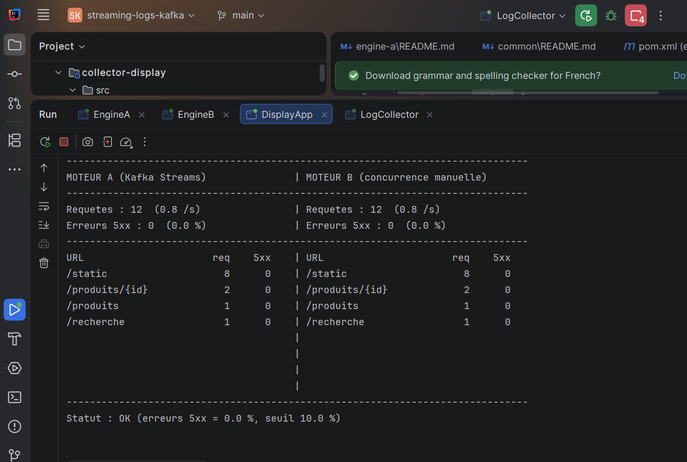

<div align="center">

# 🌊 SoukLine : analyse de logs web en temps réel

**Un vrai site e-commerce → de vrais logs → Kafka → deux moteurs de traitement parallèles → tableau de bord avec alerte.**

[](https://github.com/Bilal-Jellaoui/streaming-logs-kafka/actions/workflows/ci.yml)


*Master Big Data, IA & Applications Avancées · Université Ibn Tofaïl, Kénitra · Groupe 1 (6 membres)*



<sub>Mode panne activé : <code>/checkout</code> renvoie HTTP 503, les deux moteurs comptent <b>10 erreurs sur 40 requêtes</b> et le tableau de bord déclenche l'<b>ALERTE</b>.</sub>

</div>

---

## 📑 Sommaire

1. [Résumé](#-résumé)
2. [Architecture](#-architecture)
3. [Technologies](#-technologies)
4. [Les deux moteurs](#-les-deux-moteurs)
5. [Démarrage rapide](#-démarrage-rapide)
6. [Démo et résultats](#-démo-et-résultats)
7. [Problèmes rencontrés et solutions](#-problèmes-rencontrés-et-solutions)
8. [Tests et qualité](#-tests-et-qualité)
9. [Structure du dépôt](#-structure-du-dépôt)
10. [Équipe](#-équipe)
11. [Workflow Git](#-workflow-git)

---

## 🎯 Résumé

Le projet répond à une question simple : **comment surveiller en direct un site web à partir de ses logs, et être alerté dès que le taux d'erreurs 5xx explose ?**

Nous avons construit la chaîne complète, sur un **vrai site** et non sur des données fabriquées :

- **SoukLine**, un site e-commerce Spring Boot, écrit un vrai `access.log` Tomcat. Un **mode panne** fait renvoyer HTTP 503 à `/checkout`.
- Un **collecteur Java** suit ce fichier en continu (comme `tail -f`) et publie chaque ligne dans **Kafka** (cluster de 3 brokers, mode KRaft).
- **Deux moteurs indépendants** comptent, par URL et par fenêtre de 5 secondes, le nombre de requêtes et d'erreurs 5xx :
  **Moteur A** avec **Kafka Streams**, **Moteur B** avec la **concurrence Java faite à la main**.
- Un **tableau de bord console** affiche A et B côte à côte et **déclenche une alerte** quand les erreurs 5xx dépassent un seuil.

Les deux moteurs doivent donner **les mêmes chiffres** : c'est ce qui valide le résultat.

---

## 🏗️ Architecture



**Contrats entre les composants**

| Contrat | Valeur |
|---|---|
| Format des logs | Pattern Tomcat *common*, une ligne par requête |
| Topics Kafka | `web-logs` (8 partitions), `stats-a`, `stats-b` (réplication 3) |
| JSON des résultats | `{"engine":"A\|B","windowStart":<ms>,"url":"/checkout","requests":10,"errors5xx":10}` |
| Totaux | **Cumulatifs** : le dernier message d'une (fenêtre, URL) fait foi |
| Base de temps | L'**heure écrite dans la ligne de log**, identique pour A et B |

---

## 🧰 Technologies

| Couche | Technologie | Rôle |
|---|---|---|
| Langage | **Java 17** | Tout le code applicatif |
| Site web | **Spring Boot 3.3.4** (Tomcat embarqué) | Site e-commerce, génération des vrais logs, mode panne |
| Messagerie | **Apache Kafka 3.7.0**, KRaft, 3 brokers (Docker) | Transport des logs et des résultats, tolérance aux pannes |
| Moteur A | **Kafka Streams** | Fenêtres de 5 s, `aggregate`, `TimestampExtractor` |
| Moteur B | **`ExecutorService`**, **`ConcurrentHashMap`**, **`AtomicLong`**, **`CyclicBarrier`** | Parallélisme manuel, compteurs sans verrou |
| Charge | **Apache JMeter 5.6.3** | Trafic normal, pic, panne (3 phases) |
| Build et tests | **Maven** multi-modules, **JUnit 5** | Build, tests unitaires et d'intégration |
| CI | **GitHub Actions** | `mvn test` à chaque Pull Request |

---

## ⚙️ Les deux moteurs

Mêmes entrées, même format de sortie, deux approches :

| | **Moteur A : Kafka Streams** | **Moteur B : concurrence manuelle** |
|---|---|---|
| Idée | Topologie déclarative gérée par la bibliothèque | Tout est codé avec `java.util.concurrent` |
| Parallélisme | 2 *stream threads*, groupe de consommateurs géré par Kafka | `ExecutorService` : 4 workers, chacun avec son `KafkaConsumer` |
| Partitions | Affectées par Kafka (rééquilibrage automatique) | `consumer.assign` à la main (`partition % N == id`) : pas de rééquilibrage, **aucun doublon** |
| Compteurs | Magasin d'état Kafka Streams | `ConcurrentHashMap<String, AtomicLong>` partagé, sans verrou |
| Fin de fenêtre | `TimeWindows` 5 s, grace 5 s, commit 1 s | `CyclicBarrier` : la dernière arrivée publie les totaux dans `stats-b` |
| Code | [`engine-a/`](engine-a) | [`engine-b/`](engine-b) |

**Topologie du Moteur A :** `web-logs` → parsing → `selectKey(url)` → `groupByKey` → fenêtres de 5 s → `aggregate` (requêtes + erreurs 5xx) → JSON dans `stats-a`.

---

## 🚀 Démarrage rapide

**Prérequis :** JDK 17, Maven 3.9+, Docker, IntelliJ (ouvrir le `pom.xml` de la **racine**).

**1. Cluster Kafka** (3 brokers) et topics

```powershell
cd infra
docker compose up -d
.\scripts\create-topics.ps1
```

Les fois suivantes : `docker start soukline-kafka-1 soukline-kafka-2 soukline-kafka-3`, puis attendre 1 à 2 minutes.

**2. Site SoukLine**

```powershell
cd site
.\run.bat            # ou : .\mvnw.cmd spring-boot:run
```

Site : <http://localhost:8080/> · Mode panne : `/admin/panne?etat=on` puis `?etat=off`.

**3. Moteurs, collecteur et affichage** (classes `main`, lancées depuis IntelliJ)

| Classe | Option VM | Rôle |
|---|---|---|
| `logs.enginea.EngineA` | | Moteur A. Attendre `REBALANCING -> RUNNING` |
| `logs.engineb.EngineB` | | Moteur B. Affiche ses 4 workers et leurs partitions |
| `logs.collector.DisplayApp` | `-Dalert.threshold=10` | Tableau de bord et alerte |
| `logs.collector.LogCollector` | `-Dlog.file=site/logs/access.log` | Envoie les logs du site dans Kafka |

> Lancer le collecteur **en dernier**, puis naviguer sur le site : les lignes apparaissent dans le tableau de bord en quelques secondes.

Tous les réglages (`-D…`) sont documentés dans chaque README de module.

---

## 📊 Démo et résultats

Scénario réel, exécuté sur le cluster à 3 brokers avec les 6 composants lancés.

### Étape 1 : trafic normal
Navigation sur le site (accueil, produits, panier, recherche). Les deux moteurs affichent **les mêmes chiffres**, statut **OK**.

<p align="center"></p>

### Étape 2 : panne
`/admin/panne?etat=on` active le mode panne, puis on rafraîchit `/checkout` en continu (HTTP 503).

<p align="center"></p>

Résultat : `/checkout` = **10 requêtes, 10 erreurs 5xx**, soit **25 %** sur 40 requêtes, au-dessus du seuil de 10 % → **`!!! ALERTE`**, identique sur A et B.

<p align="center"></p>

### Étape 3 : retour à la normale
`/admin/panne?etat=off` : le site refonctionne, le tableau de bord repasse à **0 % d'erreurs 5xx**, statut **OK**.

<p align="center">
  
  
</p>

### Synthèse

| Étape | Action | Moteur A | Moteur B | Statut |
|---|---|---|---|---|
| Trafic normal | Navigation | 40 requêtes, 0 erreur | 40 requêtes, 0 erreur | ✅ OK |
| Panne | F5 sur `/checkout` | 40 requêtes, **10 erreurs (25 %)** | 40 requêtes, **10 erreurs (25 %)** | 🚨 ALERTE |
| Retour | `?etat=off` | 12 requêtes, 0 erreur | 12 requêtes, 0 erreur | ✅ OK |

**À savoir**
- Un court décalage entre A et B (quelques secondes, par exemple 16 contre 13 requêtes) est normal : ils publient leurs résultats à des instants différents. Les totaux sont ensuite **identiques**.
- Une alerte n'est émise que si la fenêtre contient **au moins 10 requêtes** (`alert.minRequests`), pour éviter les fausses alertes sur un trafic faible (2 erreurs sur 7 requêtes = 28,6 %, sans alerte).
- Le plan JMeter ([`infra/jmeter/`](infra/jmeter)) simule trois phases (normal, pic, panne) et a produit **5 000 réponses HTTP 503** pendant la phase de panne ; détails dans [`infra/README.md`](infra/README.md).
- Le **vérificateur A contre B** et le **benchmark 1/2/4/8 threads** sont développés dans [`verification-benchmark/`](verification-benchmark) (branche `feature/souhail`).

---

## 🛠️ Problèmes rencontrés et solutions

| Problème ou risque | Cause | Solution |
|---|---|---|
| **A et B comptaient dans des fenêtres différentes** | A utilisait l'heure d'envoi dans Kafka, B l'heure du log | `TimestampExtractor` personnalisé dans le Moteur A : les deux moteurs utilisent l'heure écrite dans la ligne de log |
| **Risque de requêtes comptées deux fois** dans le Moteur B | Un groupe de consommateurs rééquilibre les partitions en cours de route | `consumer.assign` manuel (`partition % N == id`) : pas de groupe, pas de rééquilibrage |
| **Le collecteur lisait un mauvais fichier** | `-Dlog.file` relatif, résolu depuis le répertoire de lancement | Chemin explicite vers `site/logs/access.log` dans la configuration de lancement |
| **Fausse alerte sur trafic faible** | 2 erreurs sur 7 requêtes dépassent déjà 10 % | Seuil minimal de requêtes (`alert.minRequests = 10`) |
| **Cluster qui boucle en `NOT_COORDINATOR`** juste après `docker start` | Élection des coordinateurs en cours | Attendre 1 à 2 minutes ; transitoire, sans perte |
| **Avertissement SLF4J (NOP)** | `slf4j-simple` 2.x avec `slf4j-api` 1.7 | Version `1.7.36` alignée dans `engine-a` et `engine-b` |
| **Décalage temporaire entre A et B à l'écran** | Instants de publication différents | Totaux cumulatifs : le dernier message d'une (fenêtre, URL) fait foi, donc convergence |

---

## ✅ Tests et qualité

| Module | Tests | Ce qui est vérifié |
|---|---|---|
| `engine-a` | 5 | Topologie, comptage 5xx, fenêtres sur l'heure du log |
| `engine-b` | 8 | Comptage, 5xx contre 404, **80 000 incréments concurrents exacts** (8 threads × 10 000), purge, JSON |
| `collector-display` | 34 | `tail -f` (ligne incomplète, rotation, fichier tronqué), lecture JSON, alerte, tableau de bord |

```bash
mvn test                      # tous les modules, depuis la racine
mvn -pl engine-b -am test     # un seul module (et `common`)
```

La CI GitHub Actions rejoue `mvn test` à chaque Pull Request, et un **relecteur approuve** avant tout merge sur `main`.

---

## 🗂️ Structure du dépôt

```text
streaming-logs-kafka/
├── common/                  LogParser, LogEntry (partagés par A et B)
├── site/                    Site SoukLine (Spring Boot), mode panne
├── infra/                   docker-compose Kafka, scripts, plans JMeter
├── collector-display/       LogCollector, DisplayApp, alerte
├── engine-a/                Moteur A : Kafka Streams
├── engine-b/                Moteur B : concurrence manuelle
├── verification-benchmark/  Vérificateur A contre B, benchmark
├── report/  testdata/       Rapport, jeux de données
├── docs/demo/               Captures de la démo
└── pom.xml                  POM parent (Java 17, Kafka 3.7.0, JUnit 5.10.2)
```

Chaque dossier a son propre `README.md` (technologies, commandes, résultats).

---

## 👥 Équipe

| Membre | Nom | Rôle | Dossier |
|---|---|---|---|
| 1 | **Mohamed Azil** | Site web, mode panne | [`site/`](site) |
| 2 | **Ali Nouar** | Infra Kafka, JMeter, intégration | [`infra/`](infra) |
| 3 | **Bilal Jellaoui** *(chef d'équipe)* | Moteur A (Kafka Streams), Parser | [`engine-a/`](engine-a), [`common/`](common) |
| 4 | **Ayoub Echihami** | Moteur B (concurrence manuelle) | [`engine-b/`](engine-b) |
| 5 | **Youssef Benayad** | Collecteur, affichage, alerte | [`collector-display/`](collector-display) |
| 6 | **Souhail El Bettachi** | Vérification A contre B, benchmark JMeter | [`verification-benchmark/`](verification-benchmark) |

**Binômes de relecture :** Mohamed ↔ Ali · Bilal ↔ Ayoub · Youssef ↔ Souhail.

---

## 🔀 Workflow Git

Personne ne pousse directement sur `main` : une branche par fonctionnalité, une Pull Request, la CI au vert, une relecture, puis le merge. Détails dans [CONTRIBUTING.md](CONTRIBUTING.md).

<div align="center">
<sub>Projet universitaire · Master BDAIA · Université Ibn Tofaïl, Kénitra · 2026</sub>
</div>
